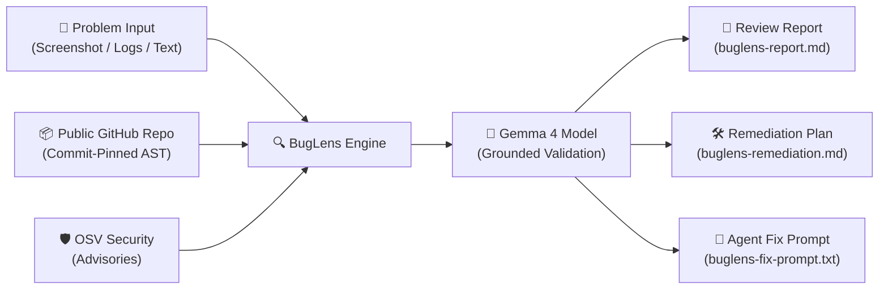
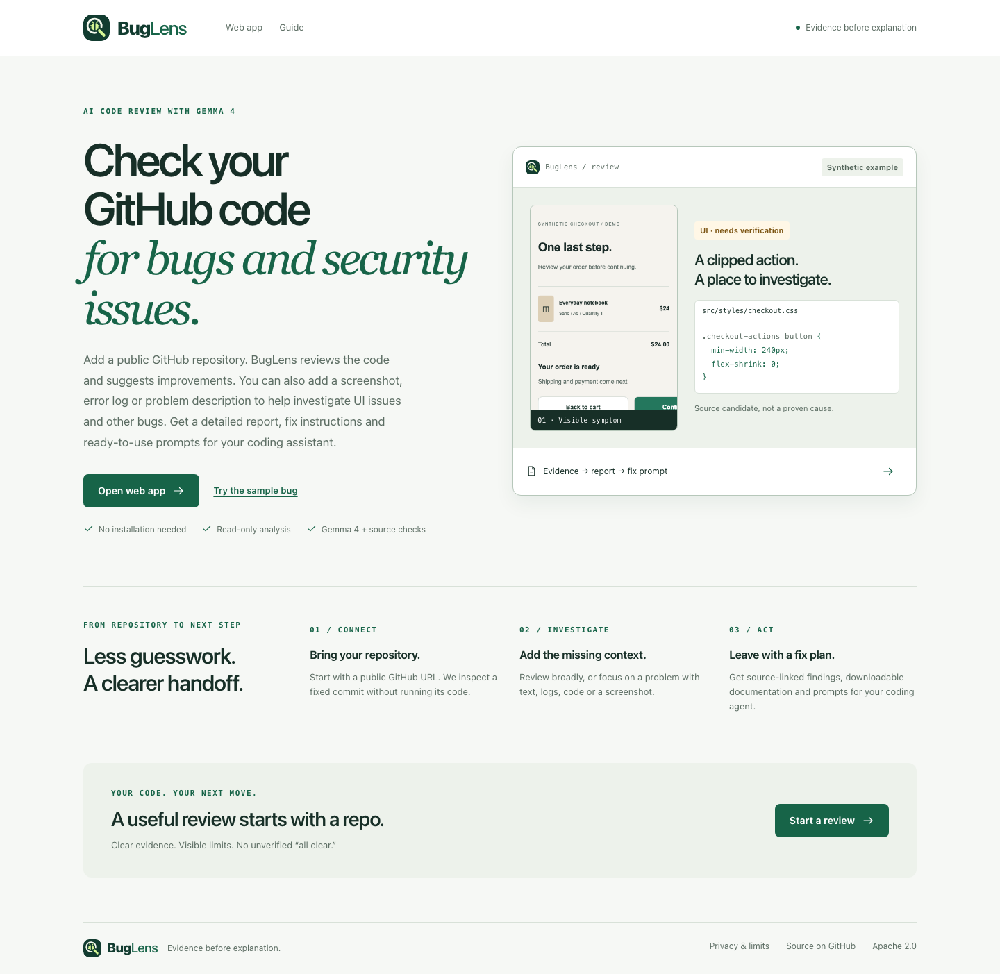
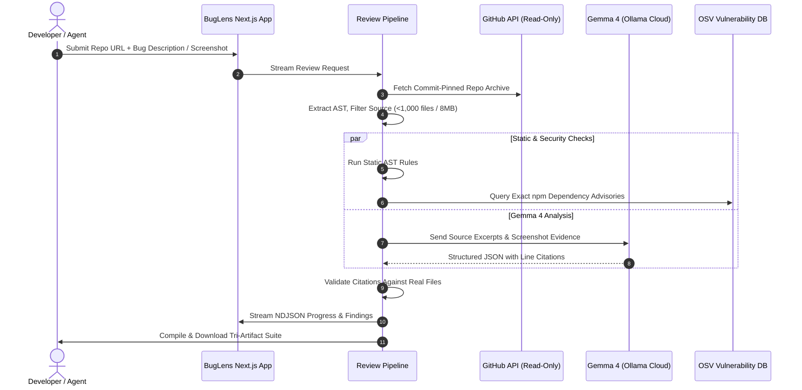

# 🔍 BugLens

<div align="center">

[](LICENSE)
[](https://nextjs.org/)
[](https://www.typescriptlang.org/)
[](https://tailwindcss.com/)
[](https://ai.google.dev/gemma)
[](docs/TEST_REPORT.md)
[](https://buglens-rust.vercel.app/demo)

### **Transform Bug Reports & Visual Symptoms into Source-Grounded Fix Blueprints**

*Evidence before explanation. Connect symptoms, code, and security advisories into actionable verification-first remediation plans.*

[**🚀 Try Live Demo**](https://buglens-rust.vercel.app/demo) • [**⚡ 90-Second Demo**](docs/DEMO_GUIDE.md) • [**🏗️ Architecture**](docs/architecture.md) • [**🤖 Agent Skill**](skills/buglens/SKILL.md) • [**📊 Verification Report**](docs/TEST_REPORT.md) • [**📦 Download Submission Package**](submission/Complete_Documentation_Package.zip)

</div>

---

## 💡 The Core Problem

When bugs strike in modern production codebases:
- A **screenshot** shows what broke visually.
- A **stack trace or log** shows where execution halted.
- The **repository** contains thousands of lines across dozens of files where the root cause might hide.

Connecting visual symptoms and crash logs to the exact lines of code—without hallucinating fixes or introducing breaking regressions—remains tedious and manual.

**BugLens bridges this gap through a grounded, repository-first intelligence pipeline:**



---

## ✨ Key Capabilities

### 1. 🔍 Strict Evidence Grounding (Zero Hallucinations)
Model findings must cite a verified file, line range, and exact code snippet present in the commit snapshot. Citations that fail syntax or file verification are automatically rejected.

### 2. 📸 Multimodal Symptom & Bug Intake
Provide raw issue descriptions, stack traces, log files, or UI screenshots (PNG, JPEG, WebP). BugLens isolates visual evidence, reporter statements, and suspected code causes into distinct verified schemas.

### 3. 🧠 Gemma 4 Code & Vision Intelligence
Powered by `gemma4:31b` via Ollama Cloud. Strict model adapters reject model drift, ensuring deterministic and reproducible analysis across complex multi-file contexts.

### 4. 🛡️ Live Dependency Security Audit
Scans exact npm lockfile dependencies against real-time OSV vulnerability databases to expose security vulnerabilities alongside functional bugs.

### 5. 🤖 Reusable AI Coding Agent Skill
Dual-entry point: use the responsive web application or invoke BugLens directly from CLI-based AI coding agents (Claude Code, Cursor, Cline, or Antigravity) via `skills/buglens/`.

### 6. 📋 Tri-Artifact Remediation Suite
Generate complete, download-ready markdown documentation and copy-ready prompts tailored for autonomous coding agents:
- `buglens-report.md`: High-level diagnostic review, citations, and scope boundaries.
- `buglens-remediation.md`: Comprehensive issue registry, affected code inventory, and acceptance criteria.
- `buglens-fix-prompt.txt`: Self-contained prompt for an autonomous coding agent to safely verify and execute the fix.

---

## 🖥️ User Interface & Workspace



*The repository-first interface featuring real-time static checks, Gemma 4 source review, and evidence-backed finding explorer.*

---

## 📦 What Developers Receive

| Artifact | Purpose | Description |
| :--- | :--- | :--- |
| **`buglens-report.md`** | Executive Findings | Complete summary of reported problem, evidence links, line-by-line inspection scope, and explicit boundary limits. |
| **`buglens-remediation.md`** | Engineering Blueprint | File inventory, problem register, specific verification targets, and unit test acceptance checklist. |
| **`buglens-fix-prompt.txt`** | Coding Agent Handoff | Self-contained, verification-first prompt instructing an AI coding agent to inspect instructions, verify the fix, and preserve unrelated code. |

---

## 🏗️ System Architecture & Data Flow



---

## 📊 Verification & Test Evidence

BugLens is tested for reliability, schema consistency, and boundary enforcement:

| Test Suite | Result | Details |
| :--- | :---: | :--- |
| **Unit & Contract Tests** | **101 / 101 Passed** | Vitest suite covering schema validation, parser robustness, and model adapters |
| **Evaluation Benchmarks** | **4 / 4 Passed** | Deterministic evaluation cases verifying evidence citation accuracy |
| **E2E Browser Journeys** | **7 / 7 Passed** | Playwright flows testing desktop & mobile journeys and ZIP artifact exports |
| **Responsive Matrix** | **Verified** | Validated across 375px, 768px, 1024px, and 1440px viewport widths |
| **Production Build** | **Success** | Next.js 15 production build with zero TypeScript warnings |

For complete test logs and evidence screenshots, see the [Comprehensive Test Report](docs/TEST_REPORT.md) and [Ollama Migration Log](docs/OLLAMA_MIGRATION.md).

---

## 🚀 Quickstart & Local Setup

### Prerequisites
- **Node.js**: `v20.18.0+`
- **npm**: `v10+`

### 1. Clone the Repository
```bash
git clone https://github.com/i-m-champion/Bug-lens.git
cd Bug-lens
```

### 2. Install Dependencies
```bash
npm ci
```

### 3. Configure Environment
```bash
cp .env.example .env.local
```

Configure optional parameters in `.env.local`:
```ini
# Server-only credential for Gemma 4 AI review via Ollama Cloud
OLLAMA_API_KEY=your_key_here

# Targeted Gemma model (Default: gemma4:31b)
GEMMA_MODEL=gemma4:31b

# Demo mode: set to 'fixture' for offline synthetic demonstration
DEMO_MODE=

# Screenshot upload limit in MB (Local default: 8, Vercel default: 4)
MAX_UPLOAD_MB=8
```

### 4. Launch Development Server
```bash
npm run dev
```
Open **`http://127.0.0.1:3000`** in your browser to access the BugLens workspace.

---

## 🧪 Development & Verification Scripts

```bash
# Run TypeScript compilation check
npm run typecheck

# Run unit and contract tests (Vitest)
npm test

# Run deterministic evaluation benchmarks
npm run evals

# Run Playwright end-to-end browser tests
npm run test:e2e

# Scan for inadvertent secrets or credential leaks
npm run check:secrets

# Build production bundle
npm run build
```

---

## 🤖 Reusable Agent Skill Integration

BugLens can be invoked programmatically as an agent skill from command-line coding workflows:

```bash
# Analyze a public repository and compile markdown report
npm run skill:review -- --github https://github.com/i-m-champion/Bug-lens --artifact report

# Package skill bundle for external agent distribution
npm run skill:package
```

Detailed skill usage, environment parameters, and prompt conventions are documented in the [BugLens Skill Guide](skills/buglens/SKILL.md).

---

## 🛡️ Privacy, Security & Scope Boundaries

- **Read-Only Inspection**: BugLens inspects default branch archives from public GitHub repositories. It never executes arbitrary code or modifies target repositories.
- **Client-Side Privacy**: Review results remain in browser session memory and are compiled dynamically on-demand.
- **Resource Bounds**: Bounded source ingestion inspects up to 150 prioritized source files / 8 MiB to protect memory limits during large-repository reviews.
- **Security Auditing**: npm dependencies are checked against real-time OSV vulnerability databases.

For in-depth security and scalability assessments, see [Security & Privacy](docs/SECURITY_AND_PRIVACY.md) and [Scalability Report](docs/SCALABILITY_REPORT.md).

---

## 📑 Complete Documentation Suite

- 📐 [Architecture & Trust Boundaries](docs/architecture.md)
- 🔄 [Detailed Processing Flowcharts](docs/FLOWCHARTS.md)
- 📡 [API Specification & Streaming Contract](docs/API_REFERENCE.md)
- 🧪 [Verification & Test Results](docs/TEST_REPORT.md)
- 📈 [Scalability Assessment & Resource Bounds](docs/SCALABILITY_REPORT.md)
- 📋 [Operations & Triage Runbook](docs/OPERATIONS_RUNBOOK.md)
- 🎥 [90-Second Demo & Presentation Guide](docs/DEMO_GUIDE.md)

---

## 👥 Hackathon Project Information

- **Project Name:** BugLens
- **Creator / Maintainer:** [Ayush](https://github.com/i-m-champion) (`@i-m-champion`)
- **Repository:** [https://github.com/i-m-champion/Bug-lens](https://github.com/i-m-champion/Bug-lens)
- **Live Deployment:** [https://buglens-rust.vercel.app](https://buglens-rust.vercel.app)

---

## 📄 License

This project is open-source and licensed under the [Apache 2.0 License](LICENSE).
